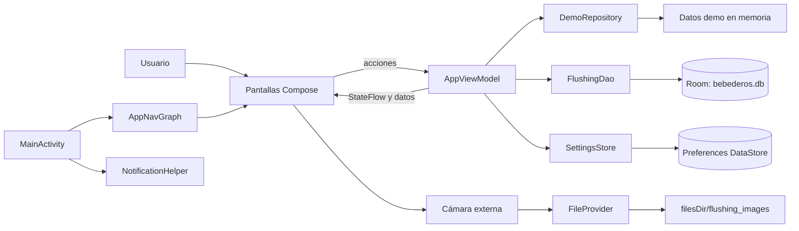

# Arquitectura de AgroBebederos-Lab

## 1. Visión general

AgroBebederos-Lab es una aplicación Android desarrollada con Kotlin y Jetpack Compose. Su arquitectura es **MVVM pragmática**: las pantallas muestran el estado, `AppViewModel` concentra la lógica de presentación y coordina las fuentes de datos, y los modelos representan el dominio.

No es una implementación de “Clean Architecture” completa. No existen capas de casos de uso ni inyección de dependencias, y `AppViewModel` crea directamente `DemoRepository`, `SettingsStore` y la base Room. Esta solución es pequeña y comprensible para el alcance académico, pero aumenta el acoplamiento del ViewModel con Android y con la persistencia.

La aplicación combina tres clases de información:

| Información | Origen real | ¿Persiste al cerrar la app? |
| --- | --- | --- |
| Usuarios, granjas, galpones, líneas, temperaturas, alertas e historial | Listas fijas de `DemoRepository` | No cambia; vuelve a construirse desde el código |
| Registros de flushing | Room, base `bebederos.db` | Sí |
| Fotografías de flushing | Almacenamiento privado `filesDir/flushing_images` | Sí, mientras no se borren los datos de la app |
| Preferencias de avisos y detalle del origen de datos | Preferences DataStore `bebederos_settings` | Sí |
| Sesión autenticada | `StateFlow` en memoria dentro de `AppViewModel` | Sobrevive a rotación, no a una muerte real del proceso |

No existe API, backend, sincronización ni medición en tiempo real. El Caso 4 permite datos simulados para el prototipo; la interfaz identifica estos datos como demostrativos.

## 2. Qué significa MVVM

MVVM separa la aplicación en tres responsabilidades:

- **Model:** datos y reglas que describen el problema. Por ejemplo, una granja, una línea o un registro de flushing.
- **View:** interfaz que el usuario ve y manipula. En este proyecto son funciones `@Composable`.
- **ViewModel:** estado y operaciones que la interfaz necesita. Recibe acciones de la View, valida, consulta o guarda datos y publica el resultado.

La intención es que una pantalla no decida por sí sola cómo autenticar, relacionar entidades o insertar en Room. La pantalla comunica la intención y observa el estado publicado por el ViewModel.

## 3. Aplicación real de MVVM en el proyecto

### Model

`app/src/main/java/cl/ariztia/bebederos/data/model/Models.kt` contiene:

- `DemoUser`, `Farm`, `Shed`, `WaterLine`, `TemperatureRecord`, `Alert` y `FlushingRecord`.
- Los enumerados `UserRole` y `TemperatureStatus`.
- `temperatureStatusFor()`, que clasifica una temperatura: normal bajo 23 °C, advertencia desde 23 °C y crítica desde 27 °C.

`FlushingEntity.kt` es el modelo de persistencia de Room. Se mantiene separado de `FlushingRecord` y se transforma mediante `toEntity()` y `toModel()`.

### Repository

`DemoRepository.kt` representa la fuente de datos demostrativos. Contiene usuarios, jerarquía productiva, temperaturas actuales, alertas, el historial de Línea 3 y tres flushing iniciales. Sus funciones buscan entidades y filtran relaciones.

Importante: este repository **no** accede a internet ni administra Room. Room se consume directamente desde `AppViewModel`. Por eso el patrón Repository se aplica solo parcialmente.

### ViewModel

`AppViewModel.kt` es el coordinador central. Sus responsabilidades reales son:

- Mantener sesión, formulario de login y estado de guardado con `StateFlow`.
- Validar correo, contraseña, motivo y observación.
- Mantener una selección coherente de granja, galpón y línea por medio de `SelectionState`.
- Exponer datos demo y resolver consultas sobre ellos.
- Aplicar filtros temporales al historial.
- Obtener fecha y hora local para nuevos flushing.
- Insertar y observar registros mediante `FlushingDao`.
- Exponer preferencias leídas desde `SettingsStore`.
- Evitar dobles envíos con `FlushingSubmissionGate`.

### Screens

Los archivos de `ui/screens` implementan la View con Compose:

- `AuthScreens.kt`: splash y login.
- `OperatorScreens.kt`: inicio de operario, líneas, detalle, formulario y confirmación de flushing, alertas.
- `SupervisorScreens.kt`: panel, granjas, galpones, historial, seguimiento de flushing y alertas.
- `ProfileScreen.kt`: perfil común a ambos roles y preferencias.

Estas pantallas reciben `AppViewModel`, recopilan sus `StateFlow` con `collectAsState()` y llaman funciones como `login()`, `selectLine()` o `registerFlushing()`.

## 4. Diagrama de arquitectura



## 5. Función de `MainActivity`

`MainActivity.kt` es el punto de entrada Android. En `onCreate()`:

1. Crea el canal de notificaciones con `NotificationHelper.createChannel()`.
2. Consulta si Android permite publicar notificaciones.
3. Instala el árbol Compose mediante `setContent` y `BebederosTheme`.
4. Crea el `NavHostController` y obtiene `AppViewModel` con `viewModel()`.
5. Observa usuario y preferencia de avisos.
6. Solicita a `NotificationHelper.showCriticalOnce()` un aviso local cuando hay sesión, permiso, preferencia activa y una línea demo crítica.
7. Monta `AppNavGraph` y le entrega las acciones de permiso y ajustes.

`onResume()` vuelve a consultar la disponibilidad de notificaciones. El permiso `POST_NOTIFICATIONS` solo se solicita al activar la opción desde el perfil en Android 13 o superior.

## 6. Navegación con `AppNavGraph`

`Routes.kt` define las rutas como cadenas. `AppNavGraph.kt` asocia cada ruta con un Composable.

Hay dos grupos de destinos raíz:

- Operario: `HomeOperario`, `Lines`, `AlertsOperario`, `ProfileOperario`.
- Supervisor: `HomeSupervisor`, `Farms`, `History`, `AlertsSupervisor`, `ProfileSupervisor`.

`go()` navega desde el menú inferior con `launchSingleTop` y `popUpTo(homeRoute)`, evitando acumular una copia por cada cambio de pestaña. `openSecondary()` se usa en flujos jerárquicos y permite que Atrás regrese al padre.

Destinos secundarios importantes son `Sheds`, `LineDetail`, `Flushing`, `FlushingOk` y `FlushingTrack`. Después de guardar, `Flushing` se elimina de la pila antes de abrir `FlushingOk`, por lo que Atrás no vuelve a un formulario ya enviado.

`AppNavGraph` también observa `currentUser`. Si una ruta protegida queda activa sin sesión, navega de manera segura a `Login` y limpia la pila.

Las rutas no llevan IDs como argumentos. El contexto seleccionado vive en `SelectionState`, dentro de `AppViewModel`. Esto simplifica la navegación, pero obliga a mantener esa selección coherente y significa que una muerte del proceso no puede reconstruir un detalle exacto desde la ruta sola.

## 7. Room: Entity, DAO, base y ViewModel

El flujo de persistencia es:

1. `FlushingRecord` representa el registro para la interfaz y la lógica.
2. `toEntity()` lo convierte en `FlushingEntity`.
3. `FlushingDao.insert()` inserta el registro en la tabla `flushings`.
4. `FlushingDao.observeAll()` devuelve un `Flow<List<FlushingEntity>>`, ordenado por ID descendente.
5. `AppViewModel.flushingList` transforma las entidades con `toModel()` y usa `stateIn()` para distinguir carga, datos listos y error.
6. El historial por línea y el seguimiento de supervisor recopilan ese flujo y se recomponen cuando cambia Room.

`AppDatabase` usa versión 3 y una sola entidad. `MIGRATION_1_2` agrega `temperatureAtRegistrationC` como `REAL` nullable y `MIGRATION_2_3` agrega `beforeTemperatureC` y `afterTemperatureC`, también nullable. La columna antigua mantiene exclusivamente su significado de contexto demo automático de la etapa 2.2; no se transforma en una medición manual. No existe migración destructiva. Si la base está vacía, el bloque `init` inserta `DemoRepository.initialFlushings`; `count()` evita duplicarlos.

La URI fotográfica se almacena como texto y el archivo reside en almacenamiento privado. Los esquemas exportados v1, v2 y v3 permiten validar tanto v2→v3 como la cadena v1→v2→v3 mediante pruebas instrumentadas.

La temperatura efectiva se deriva reactivamente de Room sin modificar `DemoRepository.lines`. Para cada combinación exacta granja–galpón–línea se elige la última medición manual posterior válida, completada y con fecha/hora válida; los empates se resuelven por ID descendente. Si no existe, permanece la temperatura demo. El rango manual centralizado es 0–50 °C: cubre agua cercana a congelación y deja margen sobre los umbrales operativos existentes, sin admitir valores físicamente inverosímiles para este flujo.

## 8. DataStore

`SettingsStore.kt` usa Preferences DataStore con el archivo lógico `bebederos_settings`. Guarda dos booleanos:

- `offline_mode`: conserva si la leyenda de origen muestra la explicación ampliada o compacta. El nombre de la clave es heredado; no detecta red ni activa sincronización.
- `critical_notifications`: expresa si el usuario desea avisos críticos.

Los `Flow<Boolean>` llegan a `AppViewModel`, donde `stateIn()` los convierte en `StateFlow`. Los cambios se escriben dentro de `viewModelScope` con `setOffline()` y `setCriticalNotifications()`.

## 9. StateFlow y recomposición

`MutableStateFlow` es un contenedor observable de estado. El ViewModel conserva la versión mutable de forma privada (`_login`, `_currentUser`, `_flushingSave`) y expone una versión de solo lectura.

En Compose, una expresión como:

```kotlin
val state by viewModel.login.collectAsState()
```

hace que la función `@Composable` se vuelva a ejecutar cuando cambia el valor. No se redibuja toda la aplicación de forma manual: Compose recompone solo los elementos que dependen de ese estado.

También existe estado local de pantalla:

- `rememberSaveable` conserva motivo, observación y URI de cámara ante rotación o recreación con estado guardado.
- `remember` se usa para estados puramente visuales breves, como un diálogo o un menú desplegable.
- El ViewModel mantiene operaciones compartidas y estados que no deben reiniciarse por una simple recomposición, como el bloqueo de guardado.

## 10. Flujo completo de una acción

Ejemplo: registrar un flushing.

1. El usuario escribe y selecciona valores en `FlushingScreen`.
2. La pantalla conserva esos campos con `rememberSaveable` y llama `viewModel.registerFlushing()`.
3. `AppViewModel` valida motivo, observación y las dos temperaturas manuales dentro de 0–50 °C.
4. Después de validar, `FlushingSubmissionGate.tryLock()` rechaza un segundo toque mientras se procesa el primero.
5. El ViewModel comprueba sesión y `SelectionState.validatedCurrent()`.
6. `FlushingTimeProvider.now()` genera fecha y hora desde un único instante y la zona local.
7. `createFlushingRecord()` arma el modelo con IDs relacionados, URI fotográfica opcional y las temperaturas manuales antes/después; el contexto automático heredado queda nulo en registros nuevos.
8. `toEntity()` lo convierte y `FlushingDao.insert()` lo guarda en Room dentro de `viewModelScope`.
9. Solo si Room devuelve un ID válido, `_flushingSave` publica `savedRecordId`.
10. `FlushingScreen`, al observar el nuevo estado, ejecuta `onSuccess()` y la navegación abre la confirmación.
11. `observeAll()` emite la nueva lista; `AppViewModel.flushingList`, `HistoryScreen` y `FlushingTrackScreen` se actualizan.

Si falla la validación, no hay sesión, la selección es incoherente o Room lanza una excepción, el ViewModel publica un mensaje y no navega a confirmación.

## 11. Límites arquitectónicos que conviene explicar

- `DemoRepository` no es una fuente remota ni persistente.
- Room persiste flushing, no temperaturas, alertas ni usuarios.
- DataStore guarda preferencias, no la sesión ni contraseñas.
- El ViewModel crea sus dependencias; no existe inyección de dependencias.
- La captura y gestión del archivo fotográfico vive en `OperatorScreens.kt`, no en una capa de datos.
- La selección jerárquica y las rutas no están serializadas; tras muerte real del proceso se vuelve al login y a la selección inicial válida.
- Las notificaciones nacen de datos demo al abrir la aplicación con una sesión; no existe monitoreo en segundo plano.
